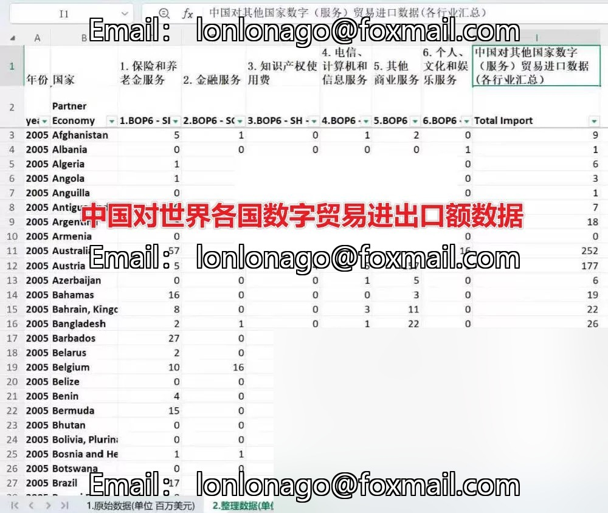
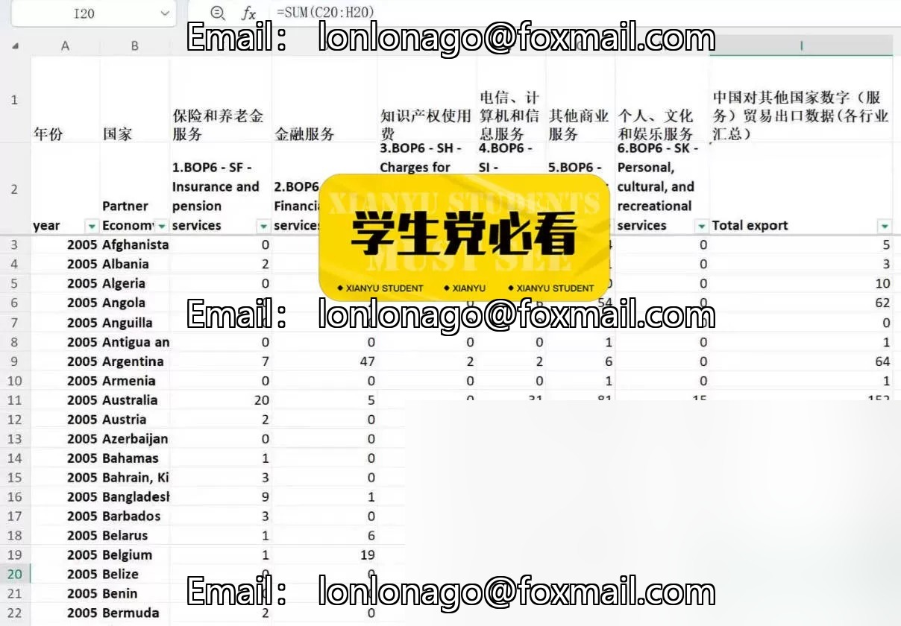
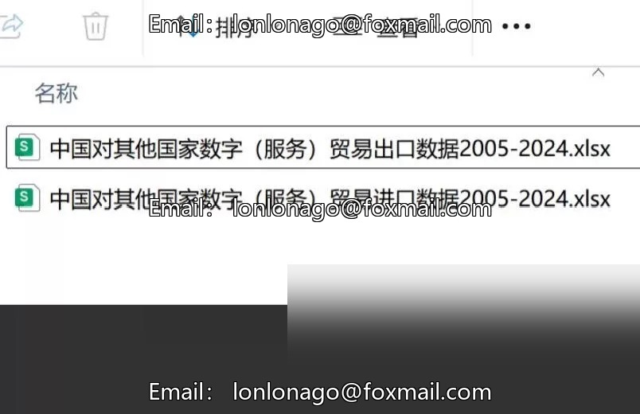

# The latest panel data on the import and export of digital (service) trade by China with world countries.

## Body

Latest panel data on China's import and export of digital (service) trade with countries around the world;
Distinction of six digital trade service departments;
(1) Insurance and pension services;
(2) Financial services;
(3) Charges for the use of intellectual property;
(4) Telecommunications, computer, and information services.

(5) Personal, cultural, and recreational services;
(6) Other business services
Year: 2005-2024
Scope: 202 countries
Data source: WTO database
online platform shipping, and deliver.

The panel data covers China's imports and exports of digital (service) trade with all countries across six sectors, spanning 2005 to 2024 and including 202 sample countries.

<!-- AI_ENRICHED -->

## Images

## Payment

Here is a pay link on Stripe ( https://buy.stripe.com/3cs8yP7sY87d0vu9AB ). Please contact me lonlonago@foxmail.com after funding $89, and I will send you a complete data files , thank you!

